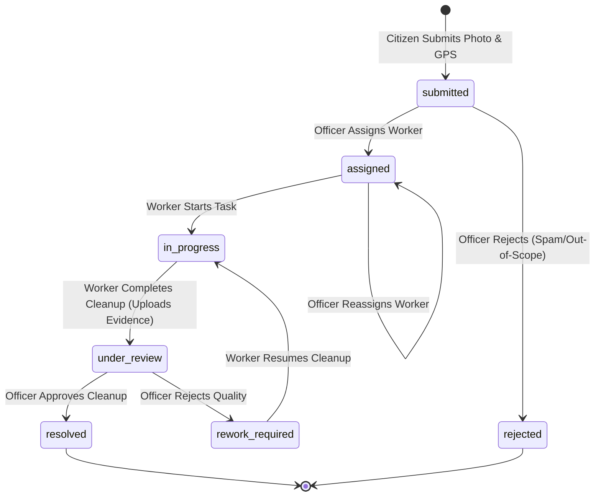

# JanSahayak Architecture Documentation

> **Academic Demonstration Project**
> Integrated Civic Assistance Platform — Gwalior, Madhya Pradesh

---

## 1. Architectural Overview

JanSahayak is designed with a modern, layered web architecture prioritizing type safety, strict security boundaries, server-side data isolation, and low-friction evaluation for academic review.

```mermaid
flowchart TD
    subgraph Client["Client Tier (Browser)"]
        PublicViews["Public Portals (Landing, Schemes, Swachh)"]
        CitizenDash["Citizen Dashboard (/citizen)"]
        WorkerDash["Worker Dashboard (/worker)"]
        OfficerDash["Officer Dashboard (/officer)"]
    end

    subgraph Server["Next.js 16 Application Server (App Router)"]
        AuthGuards["Auth & Role Guards (jose JWT Cookies)"]
        RouteHandlers["API Route Handlers (/api/*)"]
        DataAccess["Server Data-Access Layer (lib/db/*)"]
        StorageHelpers["Storage Access Layer (lib/storage/*)"]
        GeminiService["Gemini Service Stub ('server-only')"]
        ValidationLayer["Zod Validation Layer (lib/validation/*)"]
    end

    subgraph Backend["Cloud & Database Services"]
        SupabaseDB[("Supabase PostgreSQL (8 Tables)")]
        SupabaseStorage[("Supabase Storage (4 Private Buckets)")]
        GeminiAPI["Google Gemini API (Phase 4B)"]
    end

    Client -->|Signed Cookie Session| AuthGuards
    AuthGuards --> RouteHandlers
    RouteHandlers --> ValidationLayer
    ValidationLayer --> DataAccess
    ValidationLayer --> StorageHelpers
    DataAccess -->|Admin Client (Service Role)| SupabaseDB
    StorageHelpers -->|Admin Client (Signed URLs)| SupabaseStorage
    GeminiService -.->|Server-Only Execution| GeminiAPI
```

---

## 2. Authentication & Demo Role Session Architecture

JanSahayak is built for academic evaluation without requiring real-world citizen registrations, OTP gateways, or identity verification.

### Cryptographic Cookie Model
- **Library:** `jose` (standard cryptographic JWT signing with `HS256`).
- **Cookie Name:** `jansahayak_demo_session`
- **Security Flags:**
  - `HttpOnly: true` (strictly inaccessible to browser JavaScript)
  - `Secure: true` in production environments
  - `SameSite: "lax"` protection against CSRF
  - `Max-Age: 7200` (2 hours short-lived lifetime)
- **Token Signing Secret:** `DEMO_SESSION_SECRET` (minimum 32 bytes of cryptographic entropy).

### Demo User Identities
Three deterministic demo user records are mapped directly in the `demo_users` database table:
1. **Citizen (`citizen`):** Standard citizen persona reporting grievances and browsing welfare schemes.
2. **Sanitation Worker (`worker`):** Field sanitation staff assigned to Ward GWL-W-024 (Maharaj Bada / Lashkar).
3. **Municipal Officer (`officer`):** Health and sanitation administrative officer overseeing municipal sectors.

### Server Authorization Guards
- `getDemoSession()` ([`lib/auth/demo-session.ts`](file:///c:/Users/jain_/Documents/JanSahayak/jansahayak/lib/auth/demo-session.ts)): Verifies token signature and checks expiration.
- `requireDemoRole(role)` ([`lib/auth/demo-session.ts`](file:///c:/Users/jain_/Documents/JanSahayak/jansahayak/lib/auth/demo-session.ts)): Protects server-rendered dashboard pages, redirecting unauthenticated users to `/demo-role`.
- `requireApiSession(req)` ([`lib/auth/api-guards.ts`](file:///c:/Users/jain_/Documents/JanSahayak/jansahayak/lib/auth/api-guards.ts)): Validates the session cookie for API requests, returning `401 Unauthorized` on failure.
- `requireApiRole(role, req)` ([`lib/auth/api-guards.ts`](file:///c:/Users/jain_/Documents/JanSahayak/jansahayak/lib/auth/api-guards.ts)): Enforces role-specific authorization for API endpoints, returning `403 Forbidden` on role mismatch.

---

## 3. Data Access & Supabase Integration

### Client Boundary Separation
1. **Browser Client (`lib/supabase/client.ts`):** Uses `@supabase/ssr` `createBrowserClient` with public publishable key (`NEXT_PUBLIC_SUPABASE_PUBLISHABLE_KEY`).
2. **Server Client (`lib/supabase/server.ts`):** Uses `@supabase/ssr` `createServerClient` reading server-side cookies.
3. **Administrative Client (`lib/supabase/admin.ts`):** High-privilege client using `SUPABASE_SECRET_KEY`. **Strictly guarded with `import 'server-only'`** to prevent bundler leakage to client components.

### Repository Pattern (`lib/db/`)
All database operations are encapsulated in strongly-typed repository modules:
- `lib/db/complaints.ts`: Complaint creation, queries, joins, and state updates.
- `lib/db/assignments.ts`: Worker task dispatch, start, completion, and reassignment integrity.
- `lib/db/images.ts`: Metadata persistence for uploaded photos.
- `lib/db/history.ts`: Immutable complaint lifecycle audit trail logging.
- `lib/db/wards.ts`: Ward reference queries and lookups.
- `lib/db/users.ts`: Demo user resolution.
- `lib/db/ai-verifications.ts`: AI verification record stubs.

---

## 4. Private Storage Architecture

All media assets (complaint photos and cleanup evidence) are stored in **private** Supabase Storage buckets. Direct public access is disallowed.

### Storage Buckets
1. `complaint-originals`: Citizen complaint photographs.
2. `cleanup-evidence`: Field worker after-cleanup photographs.
3. `ai-annotated`: AI-generated visual overlays (Phase 4B).
4. `verification-comparisons`: Before-and-after side-by-side composite images (Phase 4B).

### Secure Access Pattern
- **Upload:** Media is validated on the server for MIME type (`image/jpeg`, `image/png`, `image/webp`) and size (max 8 MB), then uploaded via the administrative client.
- **Viewing:** The server generates short-lived **signed URLs** (`createSignedUrl`, default 1 hour) before passing URLs to client components. Raw bucket paths are never publicly exposed.
- **Compensating Rollback:** If an image upload or database record insert fails during a multi-step operation, compensating deletion removes orphaned storage objects or partial database rows.

---

## 5. Complaint State Machine

JanSahayak enforces a strict complaint lifecycle state machine to maintain operational integrity:



### Transition Integrity Rules
- **Worker Permissions:** Workers can **only** transition complaints from `assigned -> in_progress` (start) and `in_progress -> under_review` (complete). Workers **cannot** resolve or reject complaints.
- **Assignment Validation:** Assignments can only be created for complaints in `submitted`, `assigned` (reassignment), or `rework_required` statuses. Creating an assignment for complaints in `under_review`, `resolved`, or `rejected` is strictly rejected.
- **Audit History:** Every transition generates an immutable record in the `complaint_history` table recording the actor, action, previous status, new status, and remarks.

---

## 6. Google Gemini AI Dual-Key Architecture Foundation

JanSahayak employs a **dual-key, server-only Google Gemini architecture** configured to isolate conversational citizen advisory workloads from municipal officer image verification pipelines:

### 1. Dual Independent Clients
- **Chatbot Client (`lib/gemini/client.ts: getChatbotClient`):** Reads exclusively from `GEMINI_CHATBOT_API_KEY`. Defaults to model `GEMINI_CHATBOT_MODEL` (`gemini-3.8-flash`). Dedicated to Phase 4B.1 Civic RAG queries.
- **Vision Client (`lib/gemini/client.ts: getVisionClient`):** Reads exclusively from `GEMINI_VISION_API_KEY`. Defaults to model `GEMINI_VISION_MODEL` (`gemini-3.8-flash`). Dedicated to Phase 4B.2 multimodal cleanliness verification.

### 2. Strict Key Isolation & Zero Fallback
- The chatbot client **never** falls back to `GEMINI_VISION_API_KEY`.
- The vision client **never** falls back to `GEMINI_CHATBOT_API_KEY`.
- Missing configuration in either service throws an explicit, descriptive error identifying the exact missing variable without exposing any credential values.

### 3. Server-Only Protection
All modules in `lib/gemini/` (`client.ts`, `assistant.ts`, `vision.ts`, `service.ts`) are strictly guarded with `import 'server-only';`. Neither API key is prefixed with `NEXT_PUBLIC_`, preventing bundle inclusion or browser leakage.

### 4. Module Boundaries & Subsystems
- **`lib/gemini/assistant.ts`:** Text-only civic advisory engine (`answerCivicQuestion`). Implemented in Phase 4B.1 with schema-grounded deterministic retrieval and bilingual source citation.
- **`lib/gemini/vision.ts`:** Multimodal before/after cleanliness verification engine (`analyzeCleanliness`). Implemented in Phase 4B.2 with observational evidence parsing.
- **`lib/gemini/service.ts`:** Unified facade providing `getGeminiStatus()` diagnostics for both subsystems, and preserving the `@deprecated getGeminiClient()` alias mapped to the chatbot client for backward compatibility.

### 5. Multimodal Vision Verification Architecture (Phase 4B.2)
JanSahayak implements an observational, officer-assisted cleanliness verification pipeline for sanitation grievances:

- **Key Isolation & Configuration:** Driven independently by `GEMINI_VISION_API_KEY` and `GEMINI_VISION_MODEL`. Defaults to model identifier `gemini-3.8-flash`. Never accesses or falls back to chatbot credentials.
- **Explicit Officer Triggering:** Verification is never executed automatically during field worker task completion. Analysis is triggered exclusively on demand by municipal officers through `POST /api/complaints/[id]/verify` from the officer dashboard.
- **Private Server-Side Image Pipeline:** Citizen before photos (`complaint-originals`) and worker cleanup photos (`cleanup-evidence`) are retrieved server-to-server as binary buffers via administrative Supabase storage clients. No public or temporary signed URLs are passed to Gemini; raw image buffers are transmitted inline directly to Google Gemini over encrypted HTTPS.
- **Observational AI Contract:** The Vision service adheres to an observational schema (`VisionVerificationMetrics`) stored in `ai_verifications.metrics`. The AI observes site features, waste removal, surface visibility, lighting/angle limitations, and estimates qualitative waste reduction percentage (`ai_verifications.waste_reduction_percentage`).
- **Human Decision Authority:** AI outputs are strictly observational and advisory. The AI cannot approve, reject, resolve, or request rework on complaints. Municipal officers retain full, sole administrative authority to decide complaint status via `POST /api/complaints/review`.
- **Audit Persistence:** Execution records are tracked in `ai_verifications` using `processing_status` (`pending`, `completed`, `failed`), `model_name`, `model_version`, `processed_at`, and officer review synchronization fields (`human_review_status`, `reviewed_by`, `review_remarks`, `reviewed_at`).
- **Known Architecture Limitations:**
  - *Concurrency Boundary:* No database-level uniqueness or transactional lock prevents simultaneous pending verification requests if triggered concurrently within milliseconds.
  - *Process Crash Boundary:* A fatal process termination between pending-record creation and model completion could leave an orphaned `pending` record; there is currently no background TTL reaper.
  - *Chronological Ordering:* Multiple verification attempts are ordered chronologically by `created_at DESC`; there is no separate `attempt_number` column.
  - *Demonstration Demarcation:* Synthetic PNG smoke-test success demonstrates pipeline integration and schema compliance; it does not constitute independently validated municipal AI accuracy or real-world field robustness.

---

## 7. Scheme Exploration & Researched Catalogue Architecture

JanSahayak provides a standalone, bilingual Scheme Exploration module backed by a researched dataset of 50 central and state welfare initiatives:

### 1. Researched Scheme Catalogue vs. Runtime Separation
- **Runtime Application Dataset (`data/schemes/`):** Contains exactly 7 active JSON files loaded by the application (`schemes.json`, `citizen-content.json`, `sources.json`, `scheme-faqs.json`, `search-terms.json`, `scheme-service-links.json`, `scheme-grievance-links.json`). All content represents evidence-supported researched information from official portals and notifications.
- **Master Research Repository (`research/schemes/codex-output/`):** Preserves original Codex research output, RAG chunks (`rag-chunks.json`), 16 research methodology reports, validation reports, and canonical JSON schemas (`enums.json`, `proposed-application-data-contract.json`, `scheme.schema.json`). Completely isolated from runtime bundling.
- **Provisional Ward Data (`research/wards/`):** Covers 59 imported Gwalior municipal ward records pending official municipal verification.

### 2. Implemented Functionality vs. Planned Integration
- **Implemented:** Bilingual Scheme Finder and 7-tab Scheme Detail modal (`overview`, `eligibility`, `benefits`, `documents`, `steps`, `sources`, `faqs`).
- **Eligibility Engine (`lib/schemes/eligibility.ts`):** 3-state deterministic rule evaluator returning `meets`, `does_not_meet`, or `cannot_determine` (preserving epistemic integrity when scheme data is unestablished).
- **Portal Link Verification (`lib/schemes/data.ts`):** Direct application links are only surfaced for verified scheme-specific digital portals. Offline programs provide local administrative guidance.
- **Planned Work (Informational Placeholders):** The Civic Services (Tab 4) and Grievances (Tab 3) tabs currently present bilingual informational placeholders outlining upcoming workflows, pending dedicated dataset integration.
- **Gemini AI Services:** `lib/gemini/assistant.ts` (Phase 4B.1 Civic RAG) and `lib/gemini/vision.ts` (Phase 4B.2 Vision Verification) are fully implemented with dual-key isolation and server-only safety. In Scheme Exploration, the Civic Services and Grievances tabs remain informational placeholders pending dedicated dataset integration.
