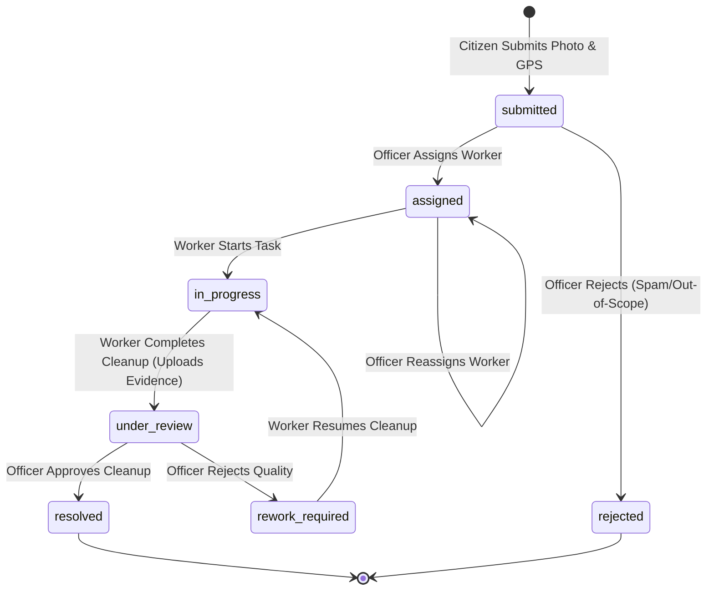

# JanSahayak Architecture Documentation

> **Academic Demonstration Project**
> Integrated Civic Assistance Platform — Gwalior, Madhya Pradesh

---

## 1. Architectural Overview

JanSahayak is designed with a modern, layered web architecture prioritizing type safety, strict security boundaries, server-side data isolation, and low-friction evaluation for academic review.

```mermaid
flowchart TD
    subgraph Client["Client Tier (Browser)"]
        PublicViews["Public Portals (Landing, Schemes, Swachh)"]
        CitizenDash["Citizen Dashboard (/citizen)"]
        WorkerDash["Worker Dashboard (/worker)"]
        OfficerDash["Officer Dashboard (/officer)"]
    end

    subgraph Server["Next.js 16 Application Server (App Router)"]
        AuthGuards["Auth & Role Guards (jose JWT Cookies)"]
        RouteHandlers["API Route Handlers (/api/*)"]
        DataAccess["Server Data-Access Layer (lib/db/*)"]
        StorageHelpers["Storage Access Layer (lib/storage/*)"]
        GeminiService["Gemini Service Stub ('server-only')"]
        ValidationLayer["Zod Validation Layer (lib/validation/*)"]
    end

    subgraph Backend["Cloud & Database Services"]
        SupabaseDB[("Supabase PostgreSQL (8 Tables)")]
        SupabaseStorage[("Supabase Storage (4 Private Buckets)")]
        GeminiAPI["Google Gemini API (Phase 4B)"]
    end

    Client -->|Signed Cookie Session| AuthGuards
    AuthGuards --> RouteHandlers
    RouteHandlers --> ValidationLayer
    ValidationLayer --> DataAccess
    ValidationLayer --> StorageHelpers
    DataAccess -->|Admin Client (Service Role)| SupabaseDB
    StorageHelpers -->|Admin Client (Signed URLs)| SupabaseStorage
    GeminiService -.->|Server-Only Execution| GeminiAPI
```

---

## 2. Authentication & Demo Role Session Architecture

JanSahayak is built for academic evaluation without requiring real-world citizen registrations, OTP gateways, or identity verification.

### Cryptographic Cookie Model
- **Library:** `jose` (standard cryptographic JWT signing with `HS256`).
- **Cookie Name:** `jansahayak_demo_session`
- **Security Flags:**
  - `HttpOnly: true` (strictly inaccessible to browser JavaScript)
  - `Secure: true` in production environments
  - `SameSite: "lax"` protection against CSRF
  - `Max-Age: 7200` (2 hours short-lived lifetime)
- **Token Signing Secret:** `DEMO_SESSION_SECRET` (minimum 32 bytes of cryptographic entropy).

### Demo User Identities
Three deterministic demo user records are mapped directly in the `demo_users` database table:
1. **Citizen (`citizen`):** Standard citizen persona reporting grievances and browsing welfare schemes.
2. **Sanitation Worker (`worker`):** Field sanitation staff assigned to Ward GWL-W-024 (Maharaj Bada / Lashkar).
3. **Municipal Officer (`officer`):** Health and sanitation administrative officer overseeing municipal sectors.

### Server Authorization Guards
- `getDemoSession()` ([`lib/auth/demo-session.ts`](file:///c:/Users/jain_/Documents/JanSahayak/jansahayak/lib/auth/demo-session.ts)): Verifies token signature and checks expiration.
- `requireDemoRole(role)` ([`lib/auth/demo-session.ts`](file:///c:/Users/jain_/Documents/JanSahayak/jansahayak/lib/auth/demo-session.ts)): Protects server-rendered dashboard pages, redirecting unauthenticated users to `/demo-role`.
- `requireApiSession(req)` ([`lib/auth/api-guards.ts`](file:///c:/Users/jain_/Documents/JanSahayak/jansahayak/lib/auth/api-guards.ts)): Validates the session cookie for API requests, returning `401 Unauthorized` on failure.
- `requireApiRole(role, req)` ([`lib/auth/api-guards.ts`](file:///c:/Users/jain_/Documents/JanSahayak/jansahayak/lib/auth/api-guards.ts)): Enforces role-specific authorization for API endpoints, returning `403 Forbidden` on role mismatch.

---

## 3. Data Access & Supabase Integration

### Client Boundary Separation
1. **Browser Client (`lib/supabase/client.ts`):** Uses `@supabase/ssr` `createBrowserClient` with public publishable key (`NEXT_PUBLIC_SUPABASE_PUBLISHABLE_KEY`).
2. **Server Client (`lib/supabase/server.ts`):** Uses `@supabase/ssr` `createServerClient` reading server-side cookies.
3. **Administrative Client (`lib/supabase/admin.ts`):** High-privilege client using `SUPABASE_SECRET_KEY`. **Strictly guarded with `import 'server-only'`** to prevent bundler leakage to client components.

### Repository Pattern (`lib/db/`)
All database operations are encapsulated in strongly-typed repository modules:
- `lib/db/complaints.ts`: Complaint creation, queries, joins, and state updates.
- `lib/db/assignments.ts`: Worker task dispatch, start, completion, and reassignment integrity.
- `lib/db/images.ts`: Metadata persistence for uploaded photos.
- `lib/db/history.ts`: Immutable complaint lifecycle audit trail logging.
- `lib/db/wards.ts`: Ward reference queries and lookups.
- `lib/db/users.ts`: Demo user resolution.
- `lib/db/ai-verifications.ts`: AI verification record stubs.

---

## 4. Private Storage Architecture

All media assets (complaint photos and cleanup evidence) are stored in **private** Supabase Storage buckets. Direct public access is disallowed.

### Storage Buckets
1. `complaint-originals`: Citizen complaint photographs.
2. `cleanup-evidence`: Field worker after-cleanup photographs.
3. `ai-annotated`: AI-generated visual overlays (Phase 4B).
4. `verification-comparisons`: Before-and-after side-by-side composite images (Phase 4B).

### Secure Access Pattern
- **Upload:** Media is validated on the server for MIME type (`image/jpeg`, `image/png`, `image/webp`) and size (max 8 MB), then uploaded via the administrative client.
- **Viewing:** The server generates short-lived **signed URLs** (`createSignedUrl`, default 1 hour) before passing URLs to client components. Raw bucket paths are never publicly exposed.
- **Compensating Rollback:** If an image upload or database record insert fails during a multi-step operation, compensating deletion removes orphaned storage objects or partial database rows.

---

## 5. Complaint State Machine

JanSahayak enforces a strict complaint lifecycle state machine to maintain operational integrity:



### Transition Integrity Rules
- **Worker Permissions:** Workers can **only** transition complaints from `assigned -> in_progress` (start) and `in_progress -> under_review` (complete). Workers **cannot** resolve or reject complaints.
- **Assignment Validation:** Assignments can only be created for complaints in `submitted`, `assigned` (reassignment), or `rework_required` statuses. Creating an assignment for complaints in `under_review`, `resolved`, or `rejected` is strictly rejected.
- **Audit History:** Every transition generates an immutable record in the `complaint_history` table recording the actor, action, previous status, new status, and remarks.

---

## 6. Google Gemini AI Boundary

The Google Gemini integration (`lib/gemini/service.ts`) is guarded with `'server-only'`. In the current phase, foundation methods (`analyzeCleanliness`, `answerCivicQuestion`) are scaffolded as safe placeholders. Live multimodal model calls are scheduled for **Phase 4B**, avoiding fabricated scores or simulated AI output in earlier phases.
