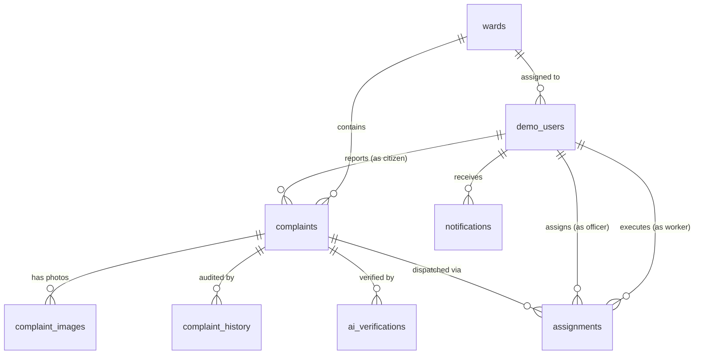

# JanSahayak Database & Storage Schema Documentation

> **Academic Demonstration Project**
> Source of Truth: Verified Supabase PostgreSQL Schema & Application Types

---

## 1. Overview

The JanSahayak database is hosted on Supabase PostgreSQL and comprises **eight operational tables** and **four private storage buckets**.

All tables utilize UUID primary keys (or deterministic string codes for administrative wards) with standard timestamp tracking (`created_at`, `updated_at`).

> [!IMPORTANT]
> **Provisional Ward Data Status:**
> The `wards` table contains 59 reference records imported from preliminary municipal data. These records represent provisional administrative boundaries and are subject to official verification by the Gwalior Municipal Corporation (GMC).

---

## 2. Entity-Relationship Model

---

## 3. Database Tables Reference

### 3.1. `wards`
Stores geographic and administrative reference metadata for Gwalior Municipal Corporation sectors.

| Column | Type | Nullable | Description |
| :--- | :--- | :--- | :--- |
| `ward_id` | `VARCHAR(32)` | **PK, No** | Primary key code (e.g., `GWL-W-024`) |
| `ward_no` | `INTEGER` | **No** | Official numerical ward number (1 to 66) |
| `ward_name` | `VARCHAR(255)` | **No** | Ward name in English |
| `ward_name_original` | `VARCHAR(255)` | Yes | Ward name in Hindi / original script |
| `lgd_code` | `VARCHAR(64)` | Yes | Local Government Directory (LGD) code |
| `city` | `VARCHAR(100)` | **No** | Municipality city (`Gwalior`) |
| `state` | `VARCHAR(100)` | **No** | State (`Madhya Pradesh`) |
| `ulb_name` | `VARCHAR(255)` | Yes | Urban Local Body name (`Gwalior Municipal Corporation`) |
| `ulb_lgd_code` | `VARCHAR(64)` | Yes | ULB LGD code |
| `latitude` | `NUMERIC(10, 7)` | Yes | Approximate geographic centroid latitude |
| `longitude` | `NUMERIC(10, 7)` | Yes | Approximate geographic centroid longitude |
| `boundary_geojson` | `JSONB` | Yes | GeoJSON representation of ward boundary polygon |
| `boundary_status` | `VARCHAR(50)` | Yes | Status of boundary data (`approximate`, `verified`) |
| `center_source` | `VARCHAR(100)` | Yes | Source of coordinate centroid |
| `councillor_name` | `VARCHAR(255)` | Yes | Elected ward councillor name |
| `supervisor_name` | `VARCHAR(255)` | Yes | Sanitation field supervisor name |
| `sanitary_inspector_name` | `VARCHAR(255)` | Yes | Sanitary inspector name |
| `sanitation_zone` | `VARCHAR(100)` | Yes | Administrative zone (e.g., `Zone 4 - Lashkar Central`) |
| `verification_status` | `VARCHAR(50)` | **No** | Boundary verification status (`pending`, `verified`) |
| `source_name` | `VARCHAR(255)` | Yes | Source file or document name |
| `source_url` | `VARCHAR(500)` | Yes | Source reference URL |
| `source_updated_at` | `TIMESTAMPTZ` | Yes | Source timestamp |
| `last_verified_at` | `TIMESTAMPTZ` | Yes | Verification timestamp |
| `notes` | `TEXT` | Yes | Administrative notes |
| `is_active` | `BOOLEAN` | **No** | Active status flag (default `true`) |
| `created_at` | `TIMESTAMPTZ` | **No** | Row creation timestamp |
| `updated_at` | `TIMESTAMPTZ` | **No** | Row update timestamp |

---

### 3.2. `demo_users`
Stores deterministic demonstration persona accounts used for academic evaluation. Additional profile metadata (email, designation, zone, avatar initials) is provided at the session layer via `DEMO_PROFILES` (`lib/auth/tokens.ts`).

| Column | Type | Nullable | Description |
| :--- | :--- | :--- | :--- |
| `id` | `UUID` | **PK, No** | Primary key |
| `display_name` | `VARCHAR(255)` | **No** | Full display name |
| `role` | `VARCHAR(50)` | **No** | Role: `citizen`, `worker`, or `officer` |
| `ward_id` | `VARCHAR(32)` | Yes | FK -> `wards.ward_id` (for worker and citizen) |
| `is_active` | `BOOLEAN` | **No** | Account active flag (default `true`) |
| `created_at` | `TIMESTAMPTZ` | **No** | Row creation timestamp |
| `updated_at` | `TIMESTAMPTZ` | **No** | Row update timestamp |

---

### 3.3. `complaints`
Stores citizen-reported sanitation grievances, location descriptions, GPS coordinates, and current lifecycle state.

| Column | Type | Nullable | Description |
| :--- | :--- | :--- | :--- |
| `id` | `UUID` | **PK, No** | Primary key |
| `complaint_code` | `VARCHAR(50)` | **No, Unique** | Human-readable code (`GWL-YYYY-XXXX`) |
| `reporter_id` | `UUID` | Yes | FK -> `demo_users.id` (Citizen who reported) |
| `ward_id` | `VARCHAR(32)` | Yes | FK -> `wards.ward_id` (GMC Ward) |
| `category` | `VARCHAR(100)` | **No** | Sanitation category enum value |
| `description` | `TEXT` | Yes | Grievance description |
| `priority` | `VARCHAR(50)` | **No** | Priority: `low`, `normal`, `high`, `urgent` |
| `location_description` | `TEXT` | Yes | Physical landmark or street address description |
| `latitude` | `NUMERIC(10, 7)` | Yes | GPS latitude |
| `longitude` | `NUMERIC(10, 7)` | Yes | GPS longitude |
| `location_accuracy_m` | `NUMERIC(8, 2)` | Yes | Geolocation accuracy in meters |
| `location_source` | `VARCHAR(50)` | Yes | Detection source (`gps`, `manual`) |
| `status` | `VARCHAR(50)` | **No** | Lifecycle status: `submitted`, `assigned`, etc. |
| `created_at` | `TIMESTAMPTZ` | **No** | Submission timestamp |
| `updated_at` | `TIMESTAMPTZ` | **No** | Update timestamp |

---

### 3.4. `complaint_images`
Stores metadata and private storage paths for all photographs associated with a complaint.

| Column | Type | Nullable | Description |
| :--- | :--- | :--- | :--- |
| `id` | `UUID` | **PK, No** | Primary key |
| `complaint_id` | `UUID` | **No** | FK -> `complaints.id` |
| `image_type` | `VARCHAR(50)` | **No** | Type: `before`, `after`, `annotated`, `comparison`, `original` |
| `bucket_name` | `VARCHAR(100)` | **No** | Private storage bucket name |
| `object_path` | `VARCHAR(500)` | **No** | Object path inside the private bucket |
| `content_type` | `VARCHAR(100)` | Yes | MIME type (`image/jpeg`, `image/png`, `image/webp`) |
| `file_size_bytes` | `BIGINT` | Yes | Size of image in bytes |
| `uploaded_by` | `UUID` | Yes | FK -> `demo_users.id` |
| `created_at` | `TIMESTAMPTZ` | **No** | Row creation timestamp |

---

### 3.5. `assignments`
Stores task dispatches allocating complaints to field sanitation workers. Note that operational dispatch instructions are audited in `complaint_history.remarks` rather than in this table.

| Column | Type | Nullable | Description |
| :--- | :--- | :--- | :--- |
| `id` | `UUID` | **PK, No** | Primary key |
| `complaint_id` | `UUID` | **No** | FK -> `complaints.id` |
| `worker_id` | `UUID` | **No** | FK -> `demo_users.id` (Sanitation worker) |
| `assigned_by` | `UUID` | Yes | FK -> `demo_users.id` (Officer who assigned) |
| `status` | `VARCHAR(50)` | **No** | Task status: `assigned`, `in_progress`, `completed`, `cancelled` |
| `assigned_at` | `TIMESTAMPTZ` | **No** | Assignment timestamp |
| `started_at` | `TIMESTAMPTZ` | Yes | Timestamp worker marked task `in_progress` |
| `completed_at` | `TIMESTAMPTZ` | Yes | Timestamp worker completed cleanup |
| `updated_at` | `TIMESTAMPTZ` | **No** | Row update timestamp |

---

### 3.6. `complaint_history`
Stores an immutable audit trail of every status transition and administrative action.

| Column | Type | Nullable | Description |
| :--- | :--- | :--- | :--- |
| `id` | `UUID` | **PK, No** | Primary key |
| `complaint_id` | `UUID` | **No** | FK -> `complaints.id` |
| `actor_id` | `UUID` | Yes | FK -> `demo_users.id` (Actor performing action) |
| `old_status` | `VARCHAR(50)` | Yes | Previous status |
| `new_status` | `VARCHAR(50)` | Yes | New status after action |
| `action` | `VARCHAR(100)` | **No** | Action name (e.g., `submitted`, `assigned`, `work_started`, `cleanup_completed`, `officer_approved`) |
| `remarks` | `TEXT` | Yes | Explanatory remarks or officer review notes |
| `created_at` | `TIMESTAMPTZ` | **No** | Event timestamp |

---

### 3.7. `ai_verifications`
Stores multimodal cleanliness verification scores and analysis from Google Gemini (Phase 4B) along with officer human review tracking.

| Column | Type | Nullable | Description |
| :--- | :--- | :--- | :--- |
| `id` | `UUID` | **PK, No** | Primary key |
| `complaint_id` | `UUID` | **No** | FK -> `complaints.id` |
| `before_image_id` | `UUID` | Yes | FK -> `complaint_images.id` (Original photo) |
| `after_image_id` | `UUID` | Yes | FK -> `complaint_images.id` (Evidence photo) |
| `processing_status` | `VARCHAR(50)` | **No** | AI status: `pending`, `completed`, `failed` |
| `model_name` | `VARCHAR(100)` | Yes | Gemini model identifier |
| `model_version` | `VARCHAR(50)` | Yes | Model release version |
| `metrics` | `JSONB` | Yes | Quantitative detection metrics |
| `waste_reduction_percentage` | `NUMERIC(5, 2)` | Yes | Estimated waste reduction percentage |
| `processing_error` | `TEXT` | Yes | Model or pipeline error message if failed |
| `processed_at` | `TIMESTAMPTZ` | Yes | Processing execution timestamp |
| `human_review_status` | `VARCHAR(50)` | **No** | Review status: `pending`, `approved`, `rejected`, `rework_required` |
| `reviewed_by` | `UUID` | Yes | FK -> `demo_users.id` (Reviewing officer) |
| `review_remarks` | `TEXT` | Yes | Officer review notes |
| `reviewed_at` | `TIMESTAMPTZ` | Yes | Officer review timestamp |
| `created_at` | `TIMESTAMPTZ` | **No** | Row creation timestamp |
| `updated_at` | `TIMESTAMPTZ` | **No** | Row update timestamp |

---

### 3.8. `notifications`
Stores in-app alerts and notifications for users.

| Column | Type | Nullable | Description |
| :--- | :--- | :--- | :--- |
| `id` | `UUID` | **PK, No** | Primary key |
| `recipient_id` | `UUID` | **No** | FK -> `demo_users.id` |
| `complaint_id` | `UUID` | Yes | FK -> `complaints.id` |
| `title` | `VARCHAR(255)` | **No** | Short notification title |
| `message` | `TEXT` | **No** | Notification body text |
| `read_at` | `TIMESTAMPTZ` | Yes | Timestamp notification was read (null if unread) |
| `created_at` | `TIMESTAMPTZ` | **No** | Row creation timestamp |

---

## 4. Supabase Storage Buckets Reference

| Bucket ID | Visibility | Purpose | Permitted MIME Types | Max File Size |
| :--- | :--- | :--- | :--- | :--- |
| `complaint-originals` | **Private** | Citizen grievance photographs | JPEG, PNG, WebP | 8 MB |
| `cleanup-evidence` | **Private** | Worker after-cleanup proof photos | JPEG, PNG, WebP | 8 MB |
| `ai-annotated` | **Private** | Gemini AI visual detection overlays | JPEG, PNG, WebP | 8 MB |
| `verification-comparisons` | **Private** | Before/after composite images | JPEG, PNG, WebP | 8 MB |

### Access & Delivery Policy
1. Direct anonymous public HTTP requests to bucket URLs are rejected with `403 Forbidden`.
2. The server generates private, time-limited signed URLs (`createSignedUrl`, default 3600 seconds) when providing image URLs to authorized clients.
3. Storage paths follow standard naming conventions: `<complaint_id>/<timestamp>_<filename>`.
