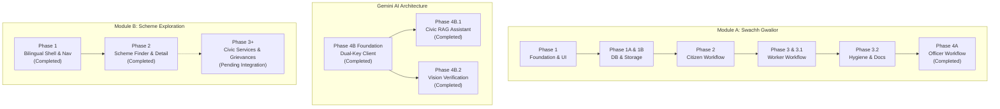

# JanSahayak Implementation Roadmap & Status

> **Academic Demonstration Project**
> Integrated Civic Assistance Platform — Gwalior, Madhya Pradesh

---

## 1. Implementation Phase Breakdown

---

## 2. Phase-by-Phase Implementation Status

### Phase 1: Modern Application Foundation & Public Architecture
**Status:** **COMPLETED**
- Modern Next.js 16 (App Router), React 19, TypeScript strict mode architecture.
- Tailwind CSS v4 styling with custom tokens and shadcn/ui component library.
- Public portals: Landing page, Swachh Gwalior portal, Scheme Exploration portal, About page, and Choose Demo Role portal.
- Cryptographic server-side demonstration session authorization using `jose` JWT cookies (`jansahayak_demo_session`).
- Visual assets: Gwalior Fort silhouette artwork, Gwalior monument logo, responsive Leaflet OpenStreetMap viewer.

---

### Phase 1A: Database & Data-Access Foundation
**Status:** **COMPLETED**
- Comprehensive inspection and mapping of the live Supabase PostgreSQL schema.
- Typed mappings for all 8 database tables in `types/database.ts`.
- Server-side data-access layer in `lib/db/` using the administrative Supabase client (`import 'server-only'`).
- Deterministic demo user resolution in `lib/db/users.ts`.
- Zod validation schemas for all domain entities in `lib/validation/`.
- Reusable API session and role guards in `lib/auth/api-guards.ts`.

---

### Phase 1B: Storage Foundation
**Status:** **COMPLETED**
- Verified the four private Supabase Storage buckets: `complaint-originals`, `cleanup-evidence`, `ai-annotated`, `verification-comparisons`.
- Server-side image upload and signed URL generation in `lib/storage/index.ts`.
- Strict image validation: MIME type enforcement (`image/jpeg`, `image/png`, `image/webp`) and 8 MB file size ceiling.
- Compensating rollback handlers to delete orphaned storage objects upon database insert failures.

---

### Phase 2: Citizen Complaint Workflow
**Status:** **COMPLETED**
- Functional citizen complaint submission form in `components/dashboards/citizen-view.tsx`.
- Photo evidence upload, ward selection (59 provisional wards), category selection, landmark descriptions, and GPS acquisition.
- Protected endpoint `POST /api/complaints` handling multi-part uploads with transactional rollback integrity.
- Protected endpoint `GET /api/complaints` with strict citizen ownership scoping (citizens see only their own complaints).
- Live complaint list with fresh signed image URLs, status badges, and expandable lifecycle timeline modal (`complaint_history`).

---

### Phase 3: Sanitation Worker Workflow
**Status:** **COMPLETED**
- Functional sanitation worker task dashboard in `components/dashboards/worker-view.tsx`.
- Protected endpoint `GET /api/tasks` returning worker assignments scoped to the worker's `dbUserId`.
- Task action `start`: Transitions assignment to `in_progress` and complaint to `in_progress`.
- Task action `complete`: Uploads after-cleanup evidence photograph to private bucket `cleanup-evidence`, marks assignment `completed`, and moves complaint to `under_review`.
- Full-screen before/after photo inspection modal with signed private URLs.

---

### Phase 3.1: Assignment Integrity & E2E Test Isolation
**Status:** **COMPLETED**
- Enforced strict pre-insertion status validation in `createAssignment()`: permits assignment only from `submitted`, `assigned` (reassignment), and `rework_required`.
- Rejects assignment from terminal states (`resolved`, `rejected`) and active states (`under_review`, `in_progress`).
- Added compensating rollback deleting inserted assignments if complaint status updates fail.
- Isolated E2E worker test suite (`scripts/test_e2e_worker.ts`) to create dedicated test complaints without mutating live or completed records.

---

### Phase 3.2: Repository Hygiene, Documentation & Alignment
**Status:** **COMPLETED**
- Removed unused dependencies (`@hookform/resolvers`, `react-hook-form`, `react-leaflet`).
- Purged unused template SVGs from `public/`.
- Strengthened `.gitignore` covering bytecode, test logs, coverage, and environment secret files.
- Aligned UI copy and descriptions across the Homepage, About page, Swachh Gwalior portal, Scheme Exploration portal, Officer Dashboard, and complaint chart.
- Created full documentation suite in `docs/` (`architecture.md`, `database.md`, `api.md`, `roadmap.md`) and updated root `README.md`.
- Verified test suite: 63/63 Node/TS tests passed, 21/21 Python tests passed, 0 ESLint errors, clean production build.

---

### Phase 4A: Municipal Officer Workflow
**Status:** **COMPLETED**
- Live Municipal Officer dashboard (`components/dashboards/officer-view.tsx`) backed by real Supabase data.
- Server-side prefetching of wards, workers, and complaints with on-demand signed URL generation for evidence photos.
- Filter toolbar supporting multi-criteria filtering across 59 GMC wards, 12 sanitation categories, and complaint lifecycle statuses.
- Protected endpoints:
  - `GET /api/complaints/[id]`: on-demand signed URL generation for detail inspection.
  - `POST /api/assignments`: worker dispatch and reassignment with cancellation safeguards.
  - `GET /api/assignments/workers`: active field sanitation worker listing.
  - `POST /api/complaints/review`: officer quality review actions (`approve` -> `resolved`, `rework` -> `rework_required`, `reject` -> `rejected`).
- State machine enforcement, immutable `complaint_history` audit logging, and in-app alerts in `notifications`.
- PostgREST 1-to-many joined assignment normalization (`normalizeActiveAssignment`).
- Verified test suite: isolated officer E2E script verified (100% pass, zero demo record mutation), 0 ESLint errors, clean production build.

---

### Scheme Exploration Phase 1 & 2: Bilingual Scheme Finder & Detail Modal
**Status:** **COMPLETED**
- Standalone runtime dataset of 50 researched government welfare schemes in `data/schemes/` (schemes, citizen content, sources, FAQs, search terms, service links, grievance links).
- Bilingual React Context (`lib/i18n/`) with English and Hindi dictionary parity and language switcher in public/dashboard headers.
- Five-tab Scheme Exploration shell (`components/scheme-exploration/scheme-support-shell.tsx`): Scheme Finder, Civic Assistant, Grievances, Civic Services, Verification & Sources.
- Scheme Finder (`components/scheme-exploration/scheme-finder.tsx`) with search across official names, aliases, and Hindi keywords, level and category filtering, and 3-state eligibility rule evaluation (`meets`, `does_not_meet`, `cannot_determine`).
- 7-tab Scheme Detail modal (`components/scheme-exploration/scheme-detail-modal.tsx`) covering overview, eligibility, benefits, documents, steps, verified sources, and bilingual FAQs with strict field-level Hindi fallback indicators.
- Verified application portal validation distinguishing scheme-specific direct digital portals from general department homepages or local physical submission channels.
- Civic Services and Grievances tabs maintained as clean bilingual informational placeholders pending future data integration.

---

### Phase 4B Foundation: Dual-Key Gemini Architecture
**Status:** **COMPLETED**
- Dual independent server-only GoogleGenAI clients (`getChatbotClient`, `getVisionClient`) in `lib/gemini/client.ts`.
- Strict key isolation between `GEMINI_CHATBOT_API_KEY` and `GEMINI_VISION_API_KEY` with zero cross-fallback.
- Independent model configuration via `GEMINI_CHATBOT_MODEL` and `GEMINI_VISION_MODEL`.
- Modular boundaries in `lib/gemini/assistant.ts` and `lib/gemini/vision.ts` with backward-compatible facade in `lib/gemini/service.ts`.
- Comprehensive key isolation and client instantiation unit tests in `tests/gemini-architecture.test.ts`.

---

### Phase 4B.1: Gemini-Powered Civic RAG Assistant
**Status:** **COMPLETED**
- Structured knowledge retrieval engine over central and Madhya Pradesh welfare schemes.
- Grounded conversational response formulation using `getChatbotClient()` (`gemini-3.8-flash`).
- Stopword leakage prevention, Devanagari transliteration mapping, and 3-state evidence sufficiency evaluation (`sufficient`, `partial`, `insufficient`).
- Bilingual citizen-facing interactive chat dialog (`components/scheme-exploration/civic-assistant.tsx`).
- Protected endpoint `POST /api/assistant` with proxy-aware IP rate limiting (10 req/min).

---

### Phase 4B.2: Gemini Vision Multimodal Cleanliness Verification
**Status:** **COMPLETED**
- Multimodal before-and-after photographic evidence comparison using `getVisionClient()` (`gemini-3.8-flash`).
- Officer-triggered observational image comparison via protected endpoint `POST /api/complaints/[id]/verify`.
- Independent Gemini Vision configuration via `GEMINI_VISION_API_KEY` and `GEMINI_VISION_MODEL`.
- Private server-side image processing: binary buffer retrieval from private Supabase Storage buckets (`complaint-originals`, `cleanup-evidence`) and inline binary transmission to Gemini over encrypted HTTPS.
- Human-in-the-loop governance: AI findings are strictly observational/advisory (`VisionVerificationMetrics`) persisted to `ai_verifications.metrics`; human municipal officers retain sole authority over approve, reject, and rework decisions.
- Controlled synthetic-image live smoke test successfully executed using isolated test fixtures. *(Demonstration boundary: synthetic smoke-test success demonstrates pipeline integration and schema compliance; it does not establish real-world model accuracy or municipal production readiness).*

---

## 3. Verified Test Suite Summary

- **Node/TS Automated Unit Tests:** 172/172 tests passing across 13 test suites (`npm test`).
- **Python Ward Reference Tests:** 21/21 tests passing (`python -m unittest tests/test_ward_import.py`).
- **Total Automated Test Count:** 193 tests (0 failing).
- **Static Analysis & Build:** 0 ESLint errors, clean Next.js Turbopack compilation across all 18 routes.

---

## 4. Known Limitations & Academic Demarcation

1. **Academic Demonstration Scope:** JanSahayak is developed as an academic demonstration prototype. It does not possess official integration with the Gwalior Municipal Corporation (GMC) or the Government of Madhya Pradesh.
2. **Provisional Ward Boundaries:** The 59 wards loaded in the database represent provisional reference boundaries pending official municipal verification.
3. **Demo Session Model:** The authentication model utilizes cryptographic server-signed demonstration cookies rather than real citizen phone numbers or SMS OTP gateways.
4. **Vision Concurrency & Process Failure Boundaries:**
   - *No DB-level concurrency lock:* No database-level uniqueness constraint or transactional mutex prevents simultaneous pending verification requests if triggered within milliseconds.
   - *Stale pending risk:* An unhandled process crash between pending-record insertion and model completion could leave an orphaned `pending` row; the system currently lacks a background TTL reaper.
   - *Chronological ordering:* Multi-attempt history is ordered strictly by `created_at DESC`; there is no dedicated `attempt_number` column.
   - *Synthetic evaluation:* Synthetic smoke-test validation confirms end-to-end integration and schema adherence, but does not establish real-world computer vision accuracy across diverse outdoor lighting and camera perspectives.
5. **Deferred Scheme Exploration Modules:** In Scheme Exploration, the Civic Services and Grievances tabs remain informational placeholders pending dedicated dataset integration.
