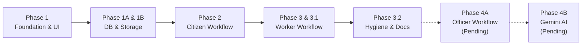

# JanSahayak Implementation Roadmap & Status

> **Academic Demonstration Project**
> Integrated Civic Assistance Platform — Gwalior, Madhya Pradesh

---

## 1. Implementation Phase Breakdown

---

## 2. Phase-by-Phase Implementation Status

### Phase 1: Modern Application Foundation & Public Architecture
**Status:** **COMPLETED**
- Modern Next.js 16 (App Router), React 19, TypeScript strict mode architecture.
- Tailwind CSS v4 styling with custom tokens and shadcn/ui component library.
- Public portals: Landing page, Swachh Gwalior portal, Scheme Exploration portal, About page, and Choose Demo Role portal.
- Cryptographic server-side demonstration session authorization using `jose` JWT cookies (`jansahayak_demo_session`).
- Visual assets: Gwalior Fort silhouette artwork, Gwalior monument logo, responsive Leaflet OpenStreetMap viewer.

---

### Phase 1A: Database & Data-Access Foundation
**Status:** **COMPLETED**
- Comprehensive inspection and mapping of the live Supabase PostgreSQL schema.
- Typed mappings for all 8 database tables in `types/database.ts`.
- Server-side data-access layer in `lib/db/` using the administrative Supabase client (`import 'server-only'`).
- Deterministic demo user resolution in `lib/db/users.ts`.
- Zod validation schemas for all domain entities in `lib/validation/`.
- Reusable API session and role guards in `lib/auth/api-guards.ts`.

---

### Phase 1B: Storage Foundation
**Status:** **COMPLETED**
- Verified the four private Supabase Storage buckets: `complaint-originals`, `cleanup-evidence`, `ai-annotated`, `verification-comparisons`.
- Server-side image upload and signed URL generation in `lib/storage/index.ts`.
- Strict image validation: MIME type enforcement (`image/jpeg`, `image/png`, `image/webp`) and 8 MB file size ceiling.
- Compensating rollback handlers to delete orphaned storage objects upon database insert failures.

---

### Phase 2: Citizen Complaint Workflow
**Status:** **COMPLETED**
- Functional citizen complaint submission form in `components/dashboards/citizen-view.tsx`.
- Photo evidence upload, ward selection (59 provisional wards), category selection, landmark descriptions, and GPS acquisition.
- Protected endpoint `POST /api/complaints` handling multi-part uploads with transactional rollback integrity.
- Protected endpoint `GET /api/complaints` with strict citizen ownership scoping (citizens see only their own complaints).
- Live complaint list with fresh signed image URLs, status badges, and expandable lifecycle timeline modal (`complaint_history`).

---

### Phase 3: Sanitation Worker Workflow
**Status:** **COMPLETED**
- Functional sanitation worker task dashboard in `components/dashboards/worker-view.tsx`.
- Protected endpoint `GET /api/tasks` returning worker assignments scoped to the worker's `dbUserId`.
- Task action `start`: Transitions assignment to `in_progress` and complaint to `in_progress`.
- Task action `complete`: Uploads after-cleanup evidence photograph to private bucket `cleanup-evidence`, marks assignment `completed`, and moves complaint to `under_review`.
- Full-screen before/after photo inspection modal with signed private URLs.

---

### Phase 3.1: Assignment Integrity & E2E Test Isolation
**Status:** **COMPLETED**
- Enforced strict pre-insertion status validation in `createAssignment()`: permits assignment only from `submitted`, `assigned` (reassignment), and `rework_required`.
- Rejects assignment from terminal states (`resolved`, `rejected`) and active states (`under_review`, `in_progress`).
- Added compensating rollback deleting inserted assignments if complaint status updates fail.
- Isolated E2E worker test suite (`scripts/test_e2e_worker.ts`) to create dedicated test complaints without mutating live or completed records.

---

### Phase 3.2: Repository Hygiene, Documentation & Alignment
**Status:** **COMPLETED (Current Phase)**
- Removed unused dependencies (`@hookform/resolvers`, `react-hook-form`, `react-leaflet`).
- Purged unused template SVGs from `public/`.
- Strengthened `.gitignore` covering bytecode, test logs, coverage, and environment secret files.
- Aligned UI copy and descriptions across the Homepage, About page, Swachh Gwalior portal, Scheme Exploration portal, Officer Dashboard, and complaint chart.
- Created full documentation suite in `docs/` (`architecture.md`, `database.md`, `api.md`, `roadmap.md`) and updated root `README.md`.
- Verified test suite: 63/63 Node/TS tests passed, 21/21 Python tests passed, 0 ESLint errors, clean production build.

---

### Phase 4A: Municipal Officer Workflow
**Status:** **PENDING**
- City-wide complaint overview and filtering across all Gwalior municipal sectors.
- Manual and semi-automated worker task dispatch/reassignment interface.
- Review queue for complaints in `under_review` status.
- Final complaint resolution (`resolved`) or rework rejection (`rework_required`) with audit notes.
- Real-time aggregation metrics and ward performance charts.

---

### Phase 4B: Google Gemini Multimodal AI Verification
**Status:** **PENDING**
- Activation of `@google/genai` server-only service in `lib/gemini/service.ts`.
- Multimodal before-and-after image comparison analyzing cleanliness and residual debris.
- Confidence scoring and qualitative cleanliness rating generation.
- Persistence of analysis results in `ai_verifications` table.
- Conversational civic assistant for Madhya Pradesh welfare scheme eligibility queries.

---

## 3. Known Limitations & Academic Demarcation

1. **Academic Demonstration Scope:** JanSahayak is developed as an academic demonstration prototype. It does not possess official integration with the Gwalior Municipal Corporation (GMC) or the Government of Madhya Pradesh.
2. **Provisional Ward Boundaries:** The 59 wards loaded in the database represent provisional reference boundaries. Official municipal GIS shapefiles and verified supervisor rosters will require official municipal coordination.
3. **Demo Session Model:** The authentication model utilizes cryptographic server-signed demonstration cookies rather than real citizen phone numbers or SMS OTP gateways.
4. **Deferred Modules:** The Municipal Officer resolution dashboard and Google Gemini AI verification workflows are staged as design placeholders and will be implemented in Phase 4.
